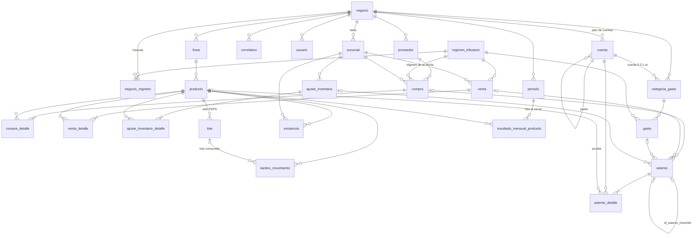

# FARO · Arquitectura

> Estado: **aprobada (tarea A3)**. Fecha: 2026-10-17.
> Plan, preguntas y respuestas: `docs/revisiones/A3.md`. Decisiones: `docs/decisiones.md`.
> Reglas de negocio y cálculo: `docs/spec.md` (este documento no las repite; dice dónde y cómo
> se implementan).

## 1. Versiones

Son las instaladas hoy en SIAP (decisión 3), leídas de `node_modules/<paquete>/package.json`.
Se fijan **exactas**, sin `^` ni `~`, con `save-exact=true` en el `.npmrc` de cada aplicación
(decisión 25).

### Entorno
| Componente | Versión |
|---|---|
| Node | 22.19.0 (`.nvmrc` → `v22.19.0`; `engines.node` → `22.19.0`) |
| npm | 10.9.x (`engines.npm`) |
| PostgreSQL | 16.15 (decisión 26) |

### Backend (`faro-backend`)
| Paquete | Versión |
|---|---|
| @nestjs/core, @nestjs/testing | 10.4.4 |
| @nestjs/common, @nestjs/platform-express | 10.4.17 |
| @nestjs/cli | 10.4.5 |
| @nestjs/typeorm | 10.0.2 |
| @nestjs/jwt | 12.0.1 |
| @nestjs/swagger | 7.4.2 |
| @nestjs/config | 3.2.3 |
| typeorm | 0.3.20 |
| pg | 8.13.0 |
| class-validator / class-transformer | 0.14.1 / 0.5.1 |
| bcrypt | 5.1.1 |
| reflect-metadata | 0.2.2 |
| dotenv | 16.4.5 (declarada como dependencia directa; en SIAP llega transitiva) |
| decimal.js | nueva en FARO: última estable al instalarla en B1, fijada exacta y anotada aquí |
| typescript | 5.6.3 |
| jest / supertest | 29.7.0 / 7.0.0 |
| eslint / prettier | 8.57.1 / 3.5.3 |

### Frontend (`faro-frontend`)
| Paquete | Versión |
|---|---|
| @angular/core (y el resto de `@angular/*` del framework) | 20.2.3 |
| @angular/material, @angular/cdk, @angular/cli, @angular/build | 20.2.1 |
| typescript | 5.8.3 |
| rxjs / zone.js | 7.8.2 / 0.15.0 |
| tailwindcss | 4.1.12 (+ `@tailwindcss/postcss` de la misma versión, nueva en FARO) |
| postcss | 8.5.6 |
| chart.js | 4.5.1 |
| date-fns | 4.1.0 |
| karma / jasmine-core | 6.4.4 / 5.1.2 |
| eslint / angular-eslint / typescript-eslint / prettier | 9.27.0 / 19.4.0 / 8.32.0 / 3.9.6 |

**No se usan** (decisión 34): `notiflix` (→ `MatSnackBar`), `moment` (→ `date-fns`),
`@fortawesome/*` (→ Material Symbols), `primeng` (decisión 4), `dhtmlx-gantt`, `leaflet`.

Un paquete nuevo que no esté en SIAP se agrega con su versión exacta en esta tabla, en la misma
tarea que lo instala.

### TypeScript
`strict: true` en backend y frontend (decisión 33). El código que se porte de SIAP
(`strictNullChecks: false`, `noImplicitAny: false`) se ajusta al portarlo.

## 2. Entorno y base de datos

- PostgreSQL 16.15 local en `localhost:5432`, el mismo servidor que usa SIAP.
- Bases:
  - `faro_dev`: desarrollo (ya existe, vacía).
  - `faro_test`: tests e2e. **Hay que crearla** (`CREATE DATABASE faro_test;`) antes de correr
    los e2e, porque estos vacían tablas. Nunca se apuntan los e2e a `faro_dev`.
- Variables de entorno en `faro-backend/`:

  | Archivo | Uso | Git |
  |---|---|---|
  | `.env.example` | Plantilla con valores de ejemplo | se commitea |
  | `.env.development` | `npm run start:dev` → `faro_dev` | **ignorado** |
  | `.env.test` | e2e → `faro_test` | **ignorado** |
  | `.env.production` | despliegue | **ignorado** |

  `.env.example`:
  ```dotenv
  DB_HOST=localhost
  DB_PORT=5432
  DB_NAME=faro_dev
  DB_USER=postgres
  DB_PASSWORD=cambiar
  JWT_SECRET=cambiar
  PORT=3000
  ```
- **Credenciales reales solo en los `.env.*` ignorados.** Nunca en `docs/`, en el código ni en
  los tests.
- `.gitignore` en la raíz del repo (decisión 42): `node_modules/`, `dist/`, `.angular/`,
  `coverage/`, `**/.env*` salvo `!**/.env.example`, y `.claude/settings.local.json` (permisos
  locales de cada equipo). `.claude/settings.json` se commitea solo si se crea uno compartido.
- `ConfigModule` (`@nestjs/config`) carga `.env.${NODE_ENV}`; ya no se usa `dotenv` a mano en
  `main.ts`.
- `synchronize: false` siempre. El esquema se crea **solo con migraciones** de TypeORM, desde la
  primera tabla (decisión 27). Las seeds (plan de cuentas semilla, regímenes, módulos y opciones
  de permisos, admin de plataforma) viven en `src/database/seeds`.
- Swagger habilitado en `/api/docs`. Prefijo global `/api`.

## 3. Carpetas

### Backend
```
faro-backend/
├── src/
│   ├── common/        entidades base, utils, filtro de errores, guards, interceptors, subscribers
│   ├── seguridad/     auth, usuario, permiso (módulo, opción, rol)
│   ├── plataforma/    negocio, régimen, sucursal, periodo, correlativo, plan, registro
│   ├── catalogo/      línea, producto, proveedor
│   ├── inventario/    existencia, lote, kardex, ajuste de inventario, valuación PPP/PEPS
│   ├── compras/
│   ├── ventas/        venta, POS
│   ├── gastos/        gasto, categoría de gasto
│   ├── contabilidad/  cuenta, asiento, constructores de asientos, control de cuadre
│   ├── cierre/        cierre y reapertura de mes, resultado mensual
│   ├── analisis/      estado de resultados, ranking, dashboard
│   ├── database/
│   │   ├── migrations/
│   │   └── seeds/
│   ├── app.module.ts
│   └── main.ts
└── test/              e2e (supertest) y su setup
```
- Dentro de cada módulo, la misma división que SIAP:
  `controllers/ dto/ entities/ services/ types/ constants/` (y `utils/` si hace falta).
- A diferencia de SIAP, **no hay carpeta intermedia `abc/`**: el módulo cuelga de `src/`.
- Un alias por módulo en `tsconfig.json` (`paths`), repetido en `moduleNameMapper` de Jest:
  `@common`, `@seguridad`, `@plataforma`, `@catalogo`, `@inventario`, `@compras`, `@ventas`,
  `@gastos`, `@contabilidad`, `@cierre`, `@analisis`, `@database`.

### Frontend
```
faro-frontend/src/
├── app/
│   ├── core/       interceptors, guards, servicios de sesión y auth, modelos HTTP
│   ├── shared/     componentes, pipes (moneda), utils
│   ├── layout/
│   └── domains/<módulo>/   mismos módulos que el backend
└── styles/         tema M3, tokens --faro-*, Tailwind
```
Aliases como SIAP: `@core`, `@shared`, `@models`, `@services`, `@guards` y `@<módulo>`.
Standalone components, signals, `input()`/`output()` y `resource()`.

## 4. Convenciones de nombres

- **Base de datos**: `snake_case`, tablas en singular, `id_<tabla>` para PK y FK
  (`@PrimaryGeneratedColumn({ name: 'id_<tabla>' })`).
- **Restricciones únicas**: índices parciales `WHERE id_estado = 1` que **incluyen
  `id_negocio`** (p. ej. `(id_negocio, codigo)` en `producto`).
- **TypeScript**: `camelCase`; clases `PascalCase`; archivos `kebab-case` con sufijo
  (`producto.entity.ts`, `producto.service.ts`, `producto.controller.ts`).
- **DTOs**: backend `CreateXDto` / `UpdateXDto` / `XFilterDto` en `create-x.dto.ts`,
  `update-x.dto.ts`, `x-filter.dto.ts`; frontend `XCreateDto`, `XUpdateDto`
  (`Entidad[Diferenciador]`, como SIAP).
- **Dominio en español** (entidades, columnas, servicios, rutas). Lo técnico del framework queda
  en inglés (`controller`, `service`, `dto`).
- **Cuentas contables**: el código usa `codigo_sistema` (`CAJA`, `BANCOS`, `CREDITO_FISCAL_IVA`,
  `INVENTARIO`, `DEBITO_FISCAL_IVA`, `IT_POR_PAGAR`, `CAPITAL`, `VENTAS`, `SOBRANTES`,
  `COSTO_VENTAS`, `PERDIDAS_INVENTARIO`, `IT_GASTO`). El código contable (`1.1.4.01`) **nunca**
  aparece en el código: solo en la seed. Las cuentas de gasto 5.2.1.xx se resuelven por
  `categoria_gasto.id_cuenta`.

## 5. Números y montos (decisión 28)

| Uso | Tipo SQL | Ejemplo |
|---|---|---|
| Montos (Bs) | `numeric(14,2)` | bruto, IVA, IT, neto, `existencia.valor`, `debe`, `haber` |
| Costos unitarios | `numeric(14,4)` | `costo_unitario`, `costo_promedio`, costo de lote |
| Cantidades | `numeric(12,3)` | productos por kilo o litro |
| Tasas | `numeric(5,4)` | `tasa_iva = 0.1300`, `tasa_it = 0.0300` |

- **Nada de `types.setTypeParser(1700, parseFloat)`**: `numeric` nunca pasa por `number`.
- Un transformer de TypeORM (`common/utils/decimal.transformer.ts`) convierte `numeric` ↔
  `Decimal` (`decimal.js`). Las entidades declaran esas columnas como `Decimal`.
- Todo cálculo de montos, costos y tasas usa `Decimal`. `common/utils/math.utils.ts` (ampliado
  respecto de SIAP) expone `redondearMonto()` (2 decimales) y `redondearCosto()` (4 decimales),
  con `ROUND_HALF_UP`.
- **API**: los montos salen como **string con 2 decimales** (`"40740.00"`). Costos unitarios,
  cantidades y tasas también salen como string, con su escala (4, 3 y 4 decimales). Los DTOs de
  entrada aceptan string numérico y se validan con `class-validator`. El frontend los modela como
  `string` y solo los formatea (pipe `moneda`), sin aritmética de punto flotante sobre montos.
- **Excepción: gráficos** (decisión 41). Para dibujar con chart.js, el frontend puede convertir el
  string a `number` en el punto donde arma los datos del gráfico. Nunca para calcular (totales,
  porcentajes, diferencias) ni para mostrar montos: etiquetas, tooltips y leyendas usan el string
  de la API con el pipe `moneda`.

### Redondeo del inventario (decisión 29)
Para que el control de cuadre de spec §5.10 (Inventario contable = stock valorado del kardex)
se cumpla siempre:
- `existencia.valor` solo cambia con **los mismos montos ya redondeados a 2 decimales** que van
  al asiento (la línea de Inventario).
- `costo_promedio = valor / cantidad`, redondeado a 4 decimales, se **recalcula en cada
  movimiento**; nunca se acumula por separado. Es un dato derivado, no la fuente del valor.
- Valor de una salida PPP = `redondearMonto(cantidad × costo_promedio)`, salvo que la salida
  deje la cantidad en 0: entonces la salida se lleva **todo el `valor` restante** (el residuo de
  centavos).
- PEPS: lo mismo por lote (`lote.cantidad_saldo`, `lote.valor_saldo`); el consumo que agota un
  lote se lleva su valor restante.
- Unit test obligatorio: una secuencia de compras y ventas con costos que no dividen exacto
  termina en stock 0 y valor 0,00, y Σ valores de salida = Σ valores de entrada.

## 6. Aislamiento por negocio (tenant) (decisión 30)

En la preliminar, a nivel de aplicación. Row-Level Security de Postgres queda para la versión
completa.

- Toda tabla de un negocio tiene `id_negocio` (FK a `negocio`) y hereda de `BaseNegocioEntity`
  (que extiende `BaseEntity`).
- El JWT lleva `{ idUsuario, idNegocio }`. `RequestContextService` (AsyncLocalStorage de SIAP)
  suma `idNegocio` a `{ idUsuario, ip, url, metodo }`.
- **El filtro por `id_negocio` vive en una base común y no se escribe a mano en cada consulta**:
  - `NegocioRepository<T>` (en `common/`) envuelve `Repository<T>` / `EntityManager` y agrega
    `id_negocio` del contexto a `find*`, `count`, `requireActiveEntity()` y a los
    `createQueryBuilder()` que crea.
  - En inserciones, `id_negocio` lo pone la base desde el contexto; el subscriber de auditoría
    lanza error si una entidad `BaseNegocioEntity` llega con un `id_negocio` distinto al del
    contexto.
  - Las consultas SQL crudas (reportes, control de cuadre) reciben `idNegocio` como parámetro
    obligatorio de la función que las arma.
- Toda referencia que llega en un DTO (producto, línea, proveedor, categoría, sucursal…) se
  carga con `NegocioRepository` antes de usarse. Si no es del negocio, responde 404 como si no
  existiera.
- Las restricciones únicas incluyen `id_negocio`.
- El admin de plataforma tiene `id_negocio = null`; los guards le niegan las rutas de negocio y
  solo entra a las de plataforma.
- **El guard valida estado en cada request**, no solo la firma y vigencia del JWT: rechaza con
  401 si el usuario está desactivado o si su negocio está suspendido (una consulta indexada
  `usuario` ⨝ `negocio` por request).
- **Test e2e obligatorio**: con dos negocios A y B, B no ve (listar, obtener) ni puede
  referenciar (usar un producto de A en una venta de B) datos de A.

## 7. Modelo de datos

### Entidades base (`common/entities`)
- `BaseEntity`: `fecha_registro`, `fecha_modificacion`, `id_estado` (1 = activo),
  `usuario_registro`, `usuario_modificacion` (como SIAP).
- `BaseNegocioEntity extends BaseEntity`: `id_negocio`.
- `BaseAnulableEntity extends BaseNegocioEntity`: `anulado`, `fecha_anulacion`,
  `usuario_anulacion`, `motivo_anulacion varchar(500)`.
- `asiento` y `asiento_detalle` **no** heredan los campos de modificación: solo `id_negocio`,
  `fecha_registro` y `usuario_registro` (son inmutables, §8).

### Diagrama ER (preliminar)


### Plataforma
- `negocio`: nombre, NIT opcional, `estado` (`ACTIVO`, `SUSPENDIDO`), `metodo_valuacion`
  (`PPP` | `PEPS`, fijo: no hay endpoint que lo cambie), `criterio_prorrateo`
  (`PORCENTAJE_VENTAS` | `UNIDADES` | `MANUAL_LINEA`).
- `sucursal`: cada negocio tiene al menos la principal (`es_principal`).
- `regimen_tributario`: catálogo global (sin `id_negocio`) con `codigo` (`GENERAL`,
  `SIMPLIFICADO`), `factura`, `tasa_iva`, `tasa_it` (`numeric(5,4)`).
- `negocio_regimen (id_negocio, id_regimen, fecha_desde)`: `fecha_desde` siempre es el día 1 de
  un mes abierto (`CHECK (extract(day from fecha_desde) = 1)` + validación de periodo en el
  servicio). Único `(id_negocio, fecha_desde)`. El régimen de una fecha es la fila con mayor
  `fecha_desde <= fecha`.
- `periodo (id_negocio, anio, mes, estado)`: `ABIERTO` | `CERRADO`, con fecha y usuario de
  cierre y de reapertura y motivo de reapertura. Único `(id_negocio, anio, mes)`. Reglas
  (decisión 39):
  - **Se crea a demanda.** El registro del negocio crea el del mes actual. Después, el primer
    documento con fecha de un mes nuevo lo crea `ABIERTO`
    (`INSERT … ON CONFLICT (id_negocio, anio, mes) DO NOTHING`) y luego lo bloquea como en §9.
  - **Fechas válidas de un documento**: no antes del primer periodo del negocio, no en un periodo
    `CERRADO` y no posteriores a hoy. Si no, 400 con mensaje en español.
  - **Se cierra en orden**: cerrar un mes exige que el anterior, si existe, esté `CERRADO`.
  - **Solo se reabre el último mes cerrado** (spec §4.9), con motivo. Al reabrir se borra la foto
    `resultado_mensual_producto` de ese periodo; se regenera al volver a cerrar.
- `correlativo (id_negocio, tipo_documento, ultimo_numero)`: un correlativo **por tipo de
  documento y por negocio** (`COMPRA`, `VENTA`, `GASTO`, `AJUSTE_INVENTARIO`, `ASIENTO`)
  (decisión 37). Se toma con `pessimistic_write` dentro de la transacción del documento.

### Documentos (decisión 37)
Una tabla por tipo, con cabecera y detalle:
- `compra` / `compra_detalle`
- `venta` / `venta_detalle`
- `gasto`
- `ajuste_inventario` / `ajuste_inventario_detalle`, con `tipo` (`INICIAL`, `MERMA`, `ROTURA`,
  `CONTEO`, …) y signo por línea. **El inventario inicial es un ajuste de tipo `INICIAL`.**

Todas las cabeceras heredan de `BaseAnulableEntity` y guardan:
- `numero` (correlativo por tipo y negocio; único `(id_negocio, numero)`), `fecha`,
  `id_sucursal`;
- el desglose completo por cabecera y por línea: bruto, descuento (0 en la preliminar), IVA, IT,
  neto y costo (decisión 14);
- `id_regimen`: copia del régimen vigente en su fecha (no se recalcula si cambia después);
- `con_factura` (compra y gasto) y `medio_pago` (`EFECTIVO` | `BANCO`/`QR`).

### Inventario
- `existencia (id_producto, id_sucursal, cantidad, costo_promedio, valor)`: el saldo actual.
  Única por `(id_producto, id_sucursal)`. Se bloquea al registrar (§9).
- `lote` (solo PEPS): documento de origen, fecha, `cantidad_inicial`, `costo_unitario`,
  `cantidad_saldo`, `valor_saldo`.
- `kardex_movimiento`: una fila por movimiento **y por lote consumido**, con tipo (entrada o
  salida), cantidad, costo unitario, valor, saldo de cantidad y de valor después del
  movimiento, `id_lote` (PEPS) y la referencia a la línea del documento que lo originó
  (`id_compra_detalle`, `id_venta_detalle`, `id_ajuste_inventario_detalle`). Por eso una
  anulación repone los lotes exactos y con el mismo costo (spec §5.2).

### Contabilidad
- `cuenta`: `codigo`, `nombre`, `tipo` (activo, pasivo, patrimonio, ingreso, costo, gasto),
  `naturaleza` (deudora | acreedora), `usa_auxiliar_producto`, `codigo_sistema` (nullable;
  único por negocio) e `id_cuenta_padre`. Se crea por negocio desde la seed (spec §5.8); solo
  lectura en la preliminar, con la excepción de las subcuentas de gasto que siguen.
- `categoria_gasto (id_negocio, nombre, id_cuenta)` (spec §4.3) (decisión 40):
  - Crear una categoría crea, **en la misma transacción**, su subcuenta `5.2.1.NN` (el siguiente
    número bajo la cuenta padre 5.2.1 del negocio, tomado con bloqueo sobre la cuenta padre) y la
    vincula en `categoria_gasto.id_cuenta`. La subcuenta no usa auxiliar de producto ni tiene
    `codigo_sistema`.
  - Desactivar la categoría (`id_estado = 0`) no borra ni desactiva la cuenta: sus asientos
    siguen apuntando a ella.
  - La seed de cada negocio incluye las categorías por defecto de spec §5.8, cada una con su
    subcuenta: Alquileres, Sueldos, Servicios básicos, Impuesto régimen simplificado y Otros.
- `asiento`:
  - `numero`, `fecha`, `glosa`, `tipo` (`AUTOMATICO` | `REVERSION` | `MANUAL`) (decisión 35).
  - Una FK opcional por tipo de documento: `id_compra`, `id_venta`, `id_gasto`,
    `id_ajuste_inventario`. Las devoluciones (versión completa) agregarán su propia FK con una
    migración.
  - `id_asiento_revertido` (FK a `asiento`).
  - Restricciones:
    ```sql
    -- exactamente un documento, salvo MANUAL, que no tiene ninguno
    CHECK (
      (tipo = 'MANUAL' AND num_nonnulls(id_compra, id_venta, id_gasto, id_ajuste_inventario) = 0)
      OR (tipo <> 'MANUAL' AND num_nonnulls(id_compra, id_venta, id_gasto, id_ajuste_inventario) = 1)
    )
    -- solo la reversión apunta al asiento revertido
    CHECK ((tipo = 'REVERSION') = (id_asiento_revertido IS NOT NULL))
    ```
  - El asiento de reversión apunta **al mismo documento** que el original y además lleva
    `id_asiento_revertido`. Índice único parcial en `id_asiento_revertido` (un asiento se
    revierte una sola vez).
- `asiento_detalle`: `id_cuenta`, `id_producto` (el auxiliar, nullable), `debe`, `haber`, con
  `CHECK ((debe > 0 AND haber = 0) OR (haber > 0 AND debe = 0))`.
- **Inmutabilidad** (decisiones 18 y 36): trigger `BEFORE UPDATE OR DELETE` en `asiento` y
  `asiento_detalle` que hace `RAISE EXCEPTION`. Anular un documento y reabrir un mes se resuelven
  con asientos nuevos, nunca editando. Los tests e2e limpian `faro_test` con
  `TRUNCATE … CASCADE` (que no dispara triggers de fila).

### Cierre
- `resultado_mensual_producto (id_periodo, id_producto, …)`: la foto del estado de resultados
  al cerrar el mes: unidades, VN, CV, pérdida de inventario, MC, G asignado, UN (spec §5.3–5.5).
  No es contable: no le aplica el trigger de inmutabilidad. Al reabrir el mes se borran sus filas
  de ese periodo y se regeneran al volver a cerrar (§7 Plataforma, decisión 39).

## 8. Servicio de asientos (spec §5.8–5.10)

- **Constructores puros por operación** (`contabilidad/services/constructores/`):
  `asientoInventarioInicial()`, `asientoCompra()`, `asientoVenta()`, `asientoCostoVenta()`,
  `asientoGasto()`, `asientoAjuste()`.
  - Reciben el documento (con sus líneas ya calculadas) y el régimen; devuelven
    `{ glosa, lineas: { codigoSistema | idCuenta, idProducto?, debe, haber }[] }` con `Decimal`.
  - Sin acceso a base de datos ni a Nest: funciones puras.
  - Los redondeos de IVA/IT se calculan por línea de producto; el ajuste de centavos contra el
    total va en la última línea (spec §5.9).
  - Unit tests con cada fila de spec §5.9 como caso (monto 100, costo 60) más casos con
    centavos.
- **`AsientoService.registrar(manager, origen, construido)`** recibe el `EntityManager` de
  quien lo llama y:
  1. verifica que el periodo de la fecha esté `ABIERTO`;
  2. resuelve las cuentas por `codigo_sistema` (o `id_cuenta` para gastos) dentro del negocio;
  3. valida que haya producto **si y solo si** la cuenta usa auxiliar;
  4. valida que Σ debe = Σ haber (con `Decimal`, exacto);
  5. toma el correlativo `ASIENTO` e inserta asiento y detalle.

  Si algo falla, lanza error y la transacción revierte todo, documento incluido. Un descuadre
  lanza `AsientoDescuadradoError` (→ 500, §10).
- **`AsientoService.revertir(manager, idAsiento, glosa)`** arma el asiento inverso (debe ↔
  haber) con `tipo = REVERSION`, la **misma fecha** que el original, el mismo documento e
  `id_asiento_revertido`. El periodo de esa fecha debe estar abierto.
- **Control de cuadre (spec §5.10)**: consultas SQL en `contabilidad/services/cuadre.service.ts`
  que reciben `idNegocio` y periodo. Las usan el cierre de mes (si no cuadra, no cierra) y la
  vista de contabilidad.

## 9. Transacciones

- **Un solo patrón**: `dataSource.transaction(async (manager) => …)`. No se usa
  `createQueryRunner` (SIAP mezcla los dos) (decisión 31).
- Los servicios que participan en una transacción reciben `manager` como **primer parámetro** y
  no abren otra.
- Orden fijo de bloqueos y pasos dentro de una operación (evita deadlocks):
  1. Asegurar el `periodo` de la fecha (crearlo `ABIERTO` con `INSERT … ON CONFLICT DO NOTHING`
     si es un mes nuevo, §7 Plataforma), validar la fecha y bloquear la fila en modo compartido
     (`pessimistic_read`). El cierre y la reapertura de mes la bloquean en modo exclusivo
     (`pessimistic_write`); el cierre bloquea también el periodo anterior para verificar que esté
     cerrado.
  2. Bloquear las `existencia` involucradas con `pessimistic_write`, **ordenadas por
     `id_producto`**.
  3. Tomar el correlativo del documento (`pessimistic_write`) y guardar el documento.
  4. Registrar el kardex (y lotes en PEPS) y actualizar `existencia`.
  5. Registrar el asiento (que toma su propio correlativo).
- Anular = mismos pasos: marcar anulado (`anularRegistro(manager, …)`), revertir el kardex con
  los mismos costos y `AsientoService.revertir()`.

## 10. Manejo de errores

- **Filtro global de excepciones** (`APP_FILTER` en `common.module.ts`) que reemplaza el
  "todo es 400" de `handleServiceError()` de SIAP (decisión 32):

  | Origen | Respuesta |
  |---|---|
  | `HttpException` | tal cual |
  | Postgres 23505 (único) | 409 |
  | Postgres 23503 (FK) | 409 |
  | Postgres 23514 (CHECK) | 400 |
  | `AsientoDescuadradoError` y el resto | 500, mensaje genérico, log con detalle |

- Las reglas de negocio lanzan `BadRequestException` (400) con un mensaje en español ("No hay
  stock suficiente de …", "El mes 2026-09 está cerrado").
- Un asiento que no cuadra es un **bug**, no un error del usuario: 500.
- Forma de la respuesta: la de Nest, `{ statusCode, message, error }`. Es compatible con
  `ApiError` (`message: string | string[]`) y `extractErrorMessage()` de SIAP, que se portan.
- `ValidationPipe({ whitelist: true, forbidNonWhitelisted: true, transform: true })`, como SIAP.
- Frontend: el interceptor de sesión cierra la sesión ante un 401; los demás errores se muestran
  con `MatSnackBar` usando `extractErrorMessage()`.

## 11. Auth y permisos (decisión 22)

- `POST /api/auth/login` (público):
  ```json
  {
    "token": "…",
    "usuario": { "id": 1, "nombre": "…", "negocio": { "id": 1, "nombre": "…" }, "rol": "Dueño" },
    "menu": [ … ],
    "permisos": [ { "modulo": "…", "opcion": "…" } ]
  }
  ```
  Credenciales malas, usuario desactivado o negocio suspendido → **401** (SIAP responde 400).
  Para el admin de plataforma, `negocio` es `null`. Se diseña desde cero, sin los campos
  heredados de SIAP.
- JWT de 12 h firmado con `JWT_SECRET`; payload `{ idUsuario, idNegocio }`. Contraseñas con
  bcrypt. `@Publico()` marca las rutas sin token, como SIAP.
- Guards globales: `JwtAuthGuard` (firma, vigencia y estado de usuario y negocio, §6) y
  `PermisoGuard`.
- **Permisos validados en el backend** (decisión 38):
  `@RequierePermiso('<módulo>', '<opción>')` en cada controlador o ruta, leyendo el esquema de
  módulos, opciones y roles portado de SIAP. El guard del frontend solo oculta menú y rutas.
- `POST /api/registro` (público) crea en **una sola transacción**: el negocio y su sucursal
  principal, el régimen inicial (`negocio_regimen` desde el día 1 del mes actual), el plan de
  cuentas semilla con las categorías de gasto por defecto y sus subcuentas 5.2.1.xx (§7), los
  roles Dueño y Empleado con sus permisos, el usuario dueño, los correlativos y el primer periodo
  (mes actual, abierto). El inventario inicial se carga después
  como ajuste `INICIAL`.

## 12. Tema Material 3 + Tailwind (decisiones 5 y 23)

Paleta **definitiva** (decisión 23, mockup aprobado en A6):

| Token | Color | Significado |
|---|---|---|
| `--faro-primario` | púrpura riqueza `#5B2A91` | utilidad, ganancia, botón principal |
| `--faro-azul` | azul FARO `#0B2F66` | marca, encabezados, navegación |
| `--faro-turquesa` | turquesa `#2FC4B2` | acento de marca (terciario M3) |
| `--faro-perdida` | naranja `#B4320E` | pérdida y alertas (error M3) |

- `mat.theme()` con paletas M3 generadas desde esos colores (primario, terciario y error).
- Las variables CSS `--faro-*` (en `styles/`) son la **única fuente** de color. Tailwind 4 las
  lee desde `@theme`; los componentes no escriben hex.
- Tailwind 4 vía `@tailwindcss/postcss` (`.postcssrc.json`), **sin preflight**, solo para layout
  y espaciado, para no pisar los estilos de Material (decisión 5).
- Tipografía única **Manrope**, con `font-variant-numeric: tabular-nums` en cifras.
- Pipe `moneda`: `"Bs 40.740,00"`, locale `es-BO`, recibe el string de la API. Con `conSigno`
  muestra `+` / `−`; utilidad, MC, resultados y variaciones **siempre** se muestran con signo
  (decisión 23). Precios y totales de una venta, sin signo.
- Ganancia y pérdida **nunca** en verde o rojo: púrpura y naranja.

## 13. Pruebas

- **Backend unit (Jest)**: constructores de asientos (filas de spec §5.9), PPP y PEPS
  (incluida la secuencia que termina en stock 0 y valor 0,00, §5), prorrateo (spec §5.4),
  `math.utils` y el transformer de `Decimal`.
- **Backend e2e (Jest + supertest) sobre `faro_test`**: aislamiento por negocio (§6), login,
  venta con su asiento y anulación con su asiento inverso, rechazo de registro en mes cerrado.
  `.env.test`; la base se migra al iniciar y se limpia con `TRUNCATE … CASCADE` entre suites.
- **Frontend**: Karma/Jasmine, como SIAP (pipe `moneda`, guards, servicios de sesión).
- Al cerrar cada tarea: tests y lint en verde.

## 14. Diferencias con SIAP

| # | SIAP | FARO | Por qué |
|---|---|---|---|
| 1 | Tailwind no está configurado (solo llega como dependencia de `@angular/build` y `@tailwindcss/forms`; tema prebuilt `azure-blue`) | Tailwind 4.1.12 configurado, sin preflight; tema M3 propio | Decisiones 5 y 23 |
| 2 | `synchronize: true`, sin migraciones | `synchronize: false`, migraciones desde la primera tabla | Esquema versionado y reproducible; triggers y CHECKs viven en migraciones. No hay ejemplos que portar de SIAP |
| 3 | Permisos solo en el frontend | `@RequierePermiso` en el backend | En un SaaS multi-negocio el backend debe impedir el acceso |
| 4 | `setTypeParser(1700, parseFloat)`; `math.utils` solo con `toFixed(2)` | `Decimal` de punta a punta; redondeo a 2 y 4 decimales | Errores de redondeo en montos contables; costos de 4 decimales (spec §5) |
| 5 | Login responde 400 ante cualquier error; ~15 campos `// No uso` | 401 con credenciales malas; respuesta mínima | Semántica HTTP correcta; contrato limpio |
| 6 | Swagger comentado | Swagger en `/api/docs` | Criterio de B1 |
| 7 | `strictNullChecks: false`, `noImplicitAny: false` | `strict: true` | Decisión 33 |
| 8 | `common/utils/anulacion.util.ts` importa `Usuario` desde `@usuario` | `common/` no depende de módulos de dominio | Dependencia oculta; se resuelve en A4 |
| 9 | `dotenv` usado en `main.ts` sin declararlo (llega transitiva) | `@nestjs/config`; `dotenv` declarado si se usa | Dependencias explícitas |
| 10 | `createQueryRunner` y `dataSource.transaction` mezclados | Solo `dataSource.transaction` con `manager` | Decisión 31 |
| 11 | `handleServiceError()`: todo lo no HTTP → 400 | Filtro global con códigos por tipo de error | Decisión 32 |
| 12 | JWT `{ idUsuario }`, selección de rol operativo | JWT `{ idUsuario, idNegocio }`, sin rol operativo | Decisión 22; tenant |
| 13 | Rangos `^` en `package.json` | Versiones exactas (`save-exact`) | Decisión 25 |
| 14 | notiflix, moment, FontAwesome, PrimeNG | MatSnackBar, date-fns, Material Symbols, solo Material | Decisiones 4 y 34 |

Las correcciones a `docs/base-desde-siap.md` que salen de esta tabla quedan para A4.
